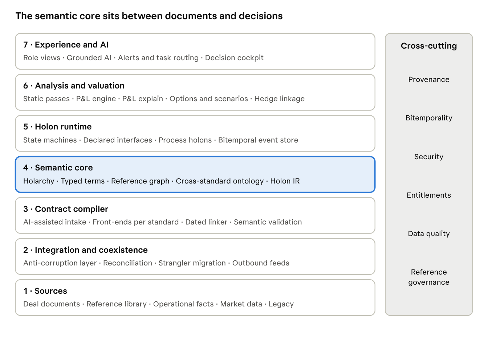

# co-holarch: Holonic Commodity Trading Architecture

A logical architecture and semantic foundation for physical commodity trading. Contracts are compiled into typed, linked holons attached to a unique cargo, so that P&L is computed from the source of truth at every moment of the cargo's life instead of being estimated and discovered at the end.



## Contents

| Path | What it holds |
| --- | --- |
| [`docs/white-paper.md`](docs/white-paper.md) | White paper: motivation, current gaps and risks, principles and invariants, domain view, the seven layers, cross-cutting concerns, cargo lifecycle map, agile increments, ontology, programme risks, glossary |
| [`docs/whiteboard.md`](docs/whiteboard.md) | Link to the shared Whiteboard with the three views of the architecture |
| [`docs/images/`](docs/images) | Architecture diagram and the three parts of the cargo lifecycle map |
| [`ontology/`](ontology) | HCTA ontology 0.1.0 (OWL) in Turtle and JSON-LD |
| [`shapes/`](shapes) | SHACL shapes encoding architecture invariants I1, I3, I4, I5 and I6 |
| [`examples/`](examples) | Worked example: a soybean chain with resale in transit (fictitious data) |
| [`context/`](context) | JSON-LD context with compact names for every term |
| [`scripts/`](scripts) | Regenerate the JSON-LD files and validate the example against the shapes |

## The six architecture invariants

| # | Invariant |
| --- | --- |
| I1 | The cargo is the root identity: everything attaches to it |
| I2 | One canonical model: no feature bypasses the holon IR |
| I3 | Every fact has provenance, valid time and known time |
| I4 | AI proposes; deterministic layers validate |
| I5 | Legacy is reached only through the anti-corruption layer |
| I6 | Reference texts are versioned and resolved by date |

I2 is enforced by architecture review; the other five are checked by the SHACL shapes.

## Ontology at a glance

The ontology has 12 modules: holon and holarchy; cargo, contracts, clauses and provisions (with temporal attachment of contracts to a cargo); parties and legal entities; reference library and dated linking; typed terms (time, quantity, money, quality); bitemporal events; lifecycle, interfaces and process holons; cost allocation and risk transfer; provenance and diagnostics; P&L, options and hedges; cross-standard concept mapping and legacy records; controlled vocabularies.

It reuses PROV-O, SKOS and OWL-Time.

| File | Triples |
| --- | --- |
| `ontology/hcta-ontology.ttl` | 1,039 |
| `shapes/hcta-shapes.ttl` | 336 |
| `examples/hcta-example-soybean.ttl` | 637 |

The namespace `https://example.org/hcta#` is a placeholder: replace it with your own before use. All names, figures, dates, form editions and hashes in the example are fictitious.

## Quick start

```bash
pip install rdflib pyshacl

# Validate the example (expected: conforms, one deliberate orphan-obligation warning)
python scripts/validate.py

# Also break five invariants in a copy and check that each one is reported
python scripts/validate.py --break

# Regenerate the JSON-LD context and JSON-LD files from the Turtle sources
python scripts/build_jsonld.py
```

The Turtle files are the source; the JSON-LD files are generated and round-trip to identical graphs.
