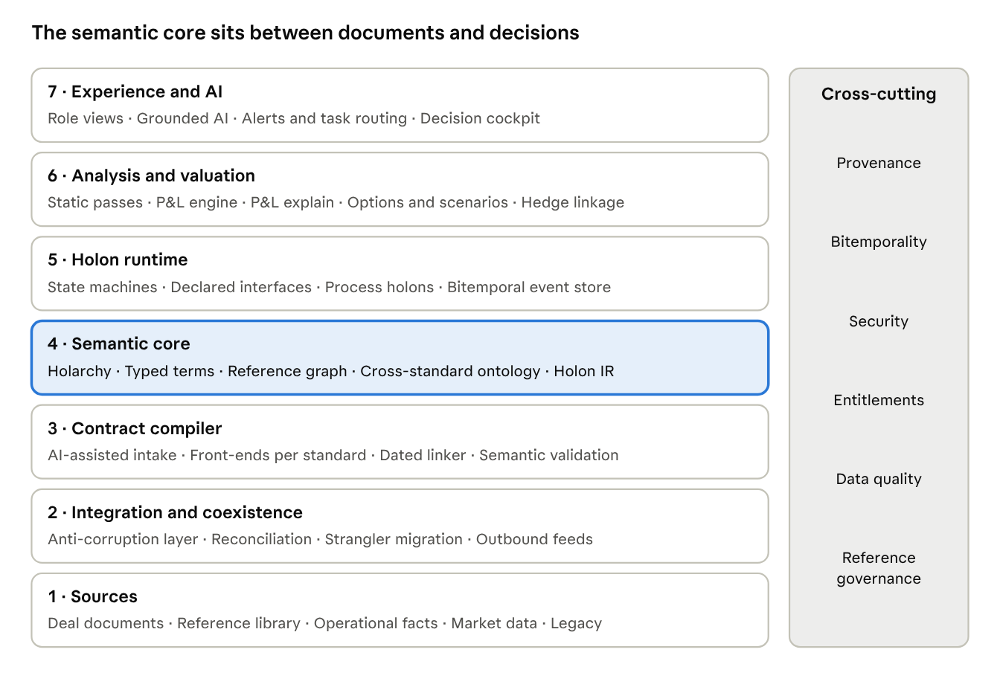
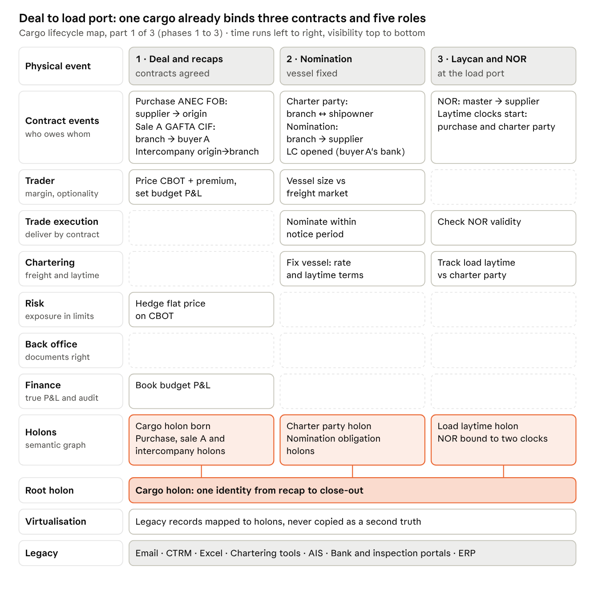
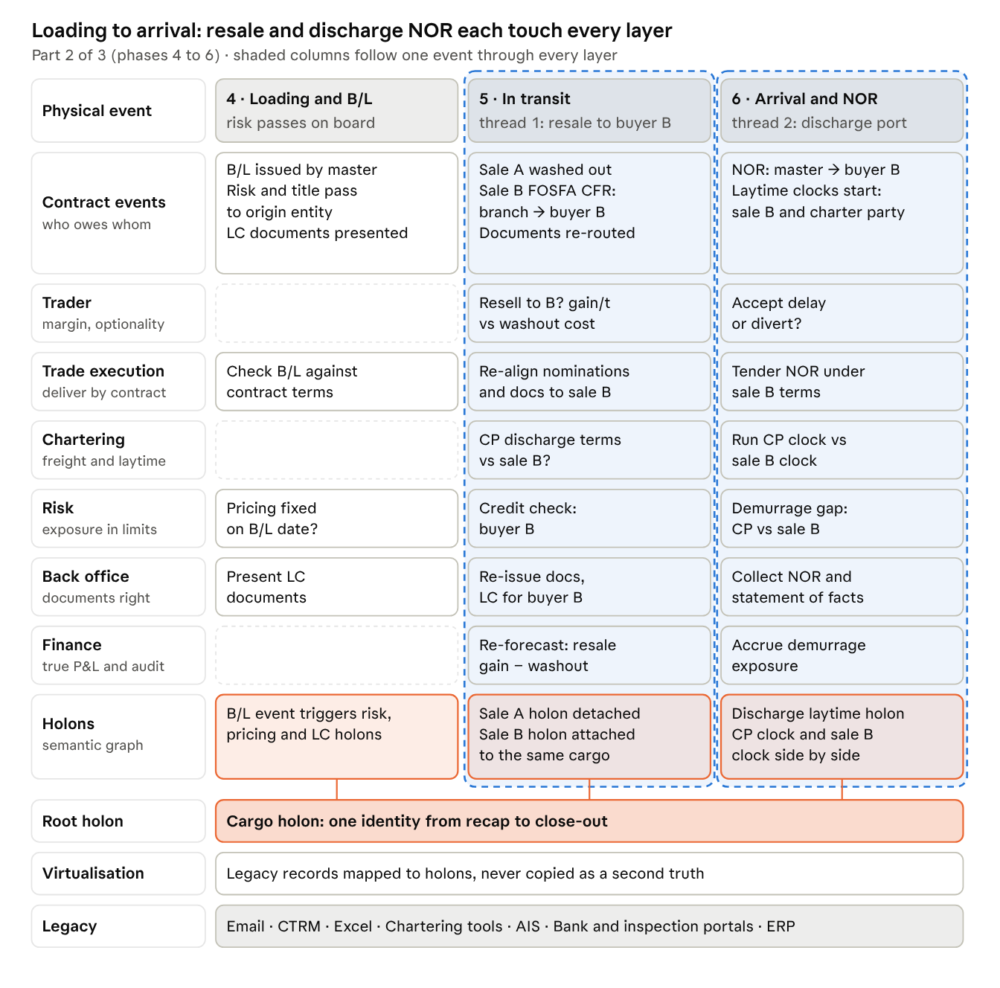
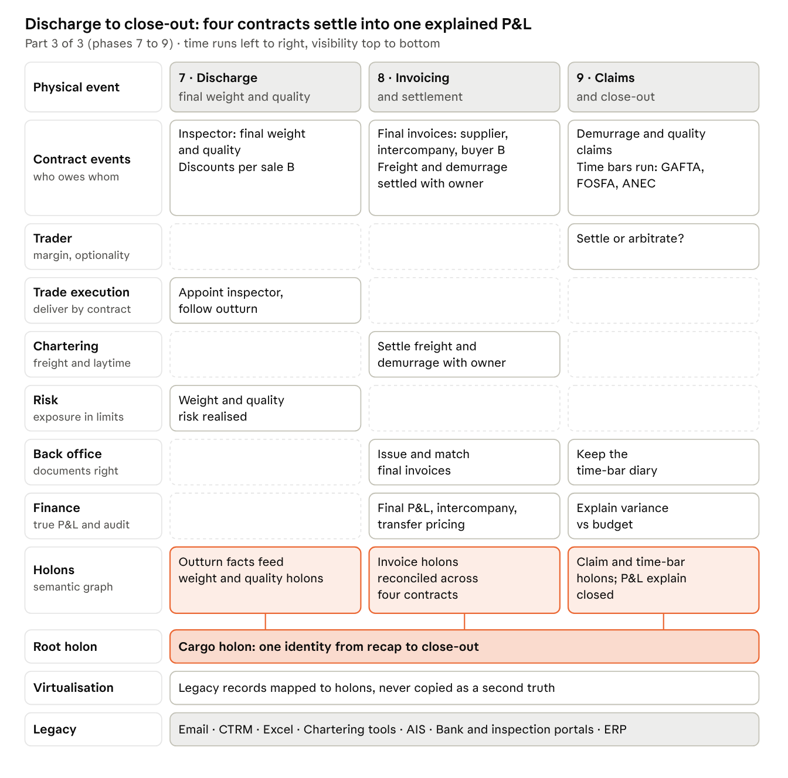

# Holonic Commodity Trading Architecture — White Paper

Version 0.1.0 · 23 November 2026

## Executive summary

Commodity trading computes P&L from a copy of its contracts that people rebuild by hand, so the real P&L of a cargo is only known after the last invoice and the audit. This paper proposes an architecture that compiles contracts into typed, linked holons attached to the cargo, so that P&L is evaluated from the source of truth at every moment of the cargo's life.

**The problem.** A physical cargo moves once, from one origin to one destination. Around it, five or more contracts are signed, washed out and replaced: purchase, intercompany, sale, charter party, letters of credit. Each contract is short but incorporates hundreds of pages of standards (GAFTA, FOSFA, ANEC, Incoterms, UCP 600) and law. Today, traders, execution, chartering, risk, back office and finance each resolve part of that meaning in their heads and pass it on through email, Excel and legacy CTRM systems. People are the compiler, the type system and the linker of the business.

**Why now.** Semantic and technical debt has grown for years without a visible bill, because human judgement contains the errors it creates. The industry now wants AI. Connected to today's flows, AI removes the human firewall without replacing it: errors that were slow and caught become fast and plausible. AI is safe only on top of a deterministic semantic layer.

**The proposal.** Six decisions carry the whole architecture:

1. **The cargo is the root of a holarchy.** Contracts attach to it and detach from it over time; every obligation, event and cash flow belongs to it.
2. **Contracts are compiled, not parsed.** Front-ends per standard, a dated linker that resolves every incorporated text at its version, semantic validation and diagnostics, with provenance to the exact source words.
3. **One canonical model.** A cross-standard ontology of holons with typed terms (time, quantity, money, quality) and an explicit reference graph.
4. **Holons are active.** Each holon has a lifecycle, declared interfaces and rules, and processes are holons that take charge of obligations.
5. **P&L is one function in three states.** Estimated, live and final P&L are the same computation over forecast, actual and final facts, so every variance is explained by clause and event.
6. **Legacy is virtualised, not replaced.** A semantic graph sits over existing systems through an anti-corruption layer, and replaces human flows step by step.

**How it gets built.** The architecture is complete at a logical level and deliberately open in its details. Leadership chooses the order of six agile increments, from a back-to-back consistency check to AI copilots. Six invariants protect the whole: whatever is built first, it extends the same core.

**What it delivers.** Fewer double payments and orphan costs, demurrage claims calculated and defended, time bars never missed, a live P&L that the business trusts, and a foundation on which AI reduces risk instead of amplifying it.

## 1. Introduction: why a new architecture

Trading houses run on a semantic model that exists only in people's heads, and that model is now the main limit on scale, control and the safe use of AI.

### 1.1 The business is a chain of linked contracts around one physical flow

A soybean cargo bought FOB in Brazil and sold CFR to a crusher in Europe or Asia is not one deal. It is a set of contracts that move together:

- a purchase from a supplier to the group's origin entity, often under an ANEC form;
- an intercompany contract from the origin entity to an international branch or trading hub;
- one or more sales from the hub to buyers, under GAFTA or FOSFA forms, sometimes washed out and replaced in transit;
- a charter party with a shipowner that sets freight, laytime and demurrage;
- letters of credit, inspection mandates and cargo insurance.

Each of these is short. A recap can fit on one page. But each incorporates by reference entire standard forms, their arbitration rules, Incoterms, UCP 600 and a governing law. The real contract is the recap plus everything it imports, resolved at the right version and in the right order of precedence.

### 1.2 People are the compiler

No system today holds that resolved meaning. People do. A trader knows what the recap implies. Execution knows which notice period applies. Chartering knows how the charter party laytime differs from the sale. Back office knows which documents the letter of credit needs. Finance reconciles what everyone else assumed.

The links between contracts, executions, operations and finance are made by people, through Excel, email and CTRM systems that are mostly legacy. People act as:

- **the parser**, reading recaps and standard forms;
- **the linker**, resolving "as per GAFTA 100" or "Incoterms 2020" to the right text;
- **the type system**, knowing that a laycan is a date range and a tolerance is a percentage at someone's option;
- **the runtime**, watching clocks, deadlines and triggers;
- **the integration layer**, re-keying the same facts from one system to the next.

This works, because experienced people catch most errors. But it does not scale, it is not reproducible, and it puts the burden of compilation on people whose job is to operate.

### 1.3 The P&L is discovered at the end

The consequence is visible in how P&L is managed. A deal is struck and back office estimates a P&L. From then on, the goal is to realise or beat that number. But the estimate is built from information that has already passed through several people, so it may not be optimal from the start. Monitoring it in real time is hard, because the dependent information is not structured or modelled. The true P&L is discovered at the end, after all the calculations and audits, and only if that exercise can be done with the precision it requires.

### 1.4 Semantic debt accumulates without a bill, until the bill arrives

Trading has traditionally preferred pragmatic IT operating costs over research and development. Modelling the supply chain is not yet seen as a must, because the P&L can be realised without it. So technical and semantic debt accumulates: every spreadsheet, every manual reconciliation, every undocumented rule held by one person.

The bill does not arrive gradually. It arrives with a black swan, a bad run of cargoes, a fraud or a regulator. The 2020 failures in Singapore's commodity sector showed cargoes financed more than once on false documents, and several banks reduced or left commodity trade finance afterwards. When the bill arrives, the architecture is needed immediately. Building it then, with feet in the mud and hands in the engine, takes years, and those years are very painful.

### 1.5 AI changes the risk, not just the productivity

Trading is attracted by AI, and rightly so. But connecting AI to today's processes and legacy systems removes the human firewall without replacing it. A person re-keying a laycan from a contract into a CTRM is slow but checks as they go. An agent doing the same is a thousand times faster and wrong in a plausible way, with no alarm. Risks that are now contained and limited by the flow between machines and minds would spread at machine speed.

AI is an excellent ally once its place in the architecture is understood: it proposes, and a deterministic semantic layer validates. **AI on legacy amplifies risk; AI on a compiled semantic layer reduces it.**

### 1.6 What this paper proposes

This paper describes a complete logical architecture, from A to Z, that removes the compilation burden from people and places it in a system. It is complete at a high level and deliberately open in its details, so development can start in agile increments chosen by the business without compromising the final architecture. Section 2 sets out the gaps and risks it addresses. Sections 3 to 8 describe each element. Section 9 introduces the ontology that serves as the semantic foundation for development.

## 2. Current state: gaps and risks

Ten gaps in today's operating model each leak P&L or create risk, and each maps to a specific part of the proposed architecture.

The examples use the reference case of this paper: a soybean cargo bought FOB Brazil under ANEC by an origin entity, passed intercompany to an international branch, sold CIF under GAFTA to buyer A, then resold CFR under FOSFA to buyer B while in transit, with a charter party fixed by the branch.

| # | Gap | Typical consequence in the soybean chain | Addressed by |
| --- | --- | --- | --- |
| G1 | Contracts exist as text, not as models | Each team re-reads the recap and the forms and reaches its own interpretation | Contract compiler, semantic core |
| G2 | Incorporated standards are not resolved | "GAFTA terms" is understood without knowing which form, which edition, which amendments | Dated linker, reference library |
| G3 | No link between linked contracts | Purchase, sale and charter party laytime terms differ and nobody sees it before the vessel arrives | Cargo holarchy, static passes |
| G4 | Cost allocation is implicit | Inspection, fumigation or LC costs are paid twice, or by nobody, across the chain | Cost allocation pass |
| G5 | Weight and quality finality mismatch | Purchase final at loading, sale final at discharge: the branch carries outturn risk without knowing it | Risk transfer and finality pass |
| G6 | Time bars are tracked by memory | A buyer's claim arrives too late to pass upstream before the supplier's time bar expires | Time-bar chain pass, runtime |
| G7 | Force majeure and default coverage gaps | The supplier invokes an event under ANEC that the sale under GAFTA or FOSFA does not accept | Coverage pass |
| G8 | P&L is estimated, then discovered | The budget P&L is built from re-keyed data and the true result appears only after audit | P&L engine, bitemporal event store |
| G9 | Re-keying between systems | Laycan, quantity and price are typed into the CTRM, Excel and bank portals by hand | Integration layer, anti-corruption layer |
| G10 | Knowledge lives in people | When a key person leaves or is absent, the rules they applied leave with them | The whole model, governance |

### 2.1 Financial risks

- **Double payments and orphan costs.** In a chain where the purchase is FOB and the sale is CFR or CIF, the branch pays freight and, under CIF, insurance. Costs at the load port such as superintendence, sampling, weighing and phytosanitary certificates can be charged under both the purchase and the sale, or fall between them. Nobody holds a cost allocation matrix across the chain.
- **Unrecovered demurrage.** The branch pays the shipowner under the charter party. It recovers from the supplier at the load port and from the buyer at discharge, under different laytime terms. Every difference between the clocks is P&L that leaks.
- **Quality and weight discounts that cannot be passed on.** A moisture discount accepted under the sale may not be recoverable under the purchase if the quality terms or the place of finality differ.
- **Pricing basis mismatches.** Soybeans are typically priced as a CBOT futures reference plus a premium. Different pricing periods or fixing rules between purchase and sale create exposure that the hedge does not cover.

### 2.2 Legal and operational risks

- **Time bars.** GAFTA, FOSFA and ANEC each set claim and arbitration deadlines. A notice chain that does not leave time to pass a claim upstream turns a recoverable loss into a final one.
- **Inconsistent forums.** A purchase arbitrated under ANEC rules and a sale arbitrated in London under GAFTA or FOSFA rules can produce inconsistent outcomes on the same facts.
- **Coverage gaps.** Prohibition, force majeure and default clauses that do not line up leave the branch in default to its buyer without recourse to its supplier.
- **Resale in transit.** Washing out sale A and fixing sale B changes the destination, the documents, the letter of credit and the discharge laytime. Each of these changes is made by a different person.

### 2.3 Control, audit and tax risks

- **Reproducibility.** A P&L or a demurrage claim that cannot be recomputed from its sources is weak in an audit and in an arbitration.
- **Intercompany and transfer pricing.** Which entity bears which costs and risks must match its functions. Today that consistency is checked after the fact, if at all.
- **Duplicate financing.** Without a unique cargo identity linked to its documents, the same cargo can be presented to more than one financier.

### 2.4 Technology risks

- **Legacy CTRMs hold the data that people typed, not the meaning of the contracts.** They compute correctly on inputs that may already be wrong.
- **Spreadsheets carry critical logic.** Laytime calculations, P&L bridges and cost allocations live in personal files without versioning or review.
- **AI on top of this stack** inherits all of the above and removes the human check that contained it (see 1.5).

The architecture does not remove these risks by adding controls on top of existing flows. It removes them by modelling the meaning that people currently carry, so that the controls become computations.

## 3. Design principles and architecture invariants

The architecture rests on six principles and six invariants: the principles explain the choices, the invariants are the rules no increment may break.

### 3.1 Principles

1. **Compile, don't parse.** Extracting text and structure is not enough. The system must resolve references, type every measure, validate meaning and report what it cannot resolve. The output is a model that can be executed and checked, not a JSON copy of a PDF.
2. **The physical flow is the anchor.** A cargo moves once, from one place to another. Buyers, prices and documents change around it. Modelling around the cargo, not around the deal or the contract, gives every other object a stable identity.
3. **Holons, not records.** Each unit of the model is a holon in Koestler's sense: a whole in itself and a part of a larger whole. A provision is complete enough to be evaluated alone, and it is part of a clause, a contract and a cargo. Holons have behaviour, not just data.
4. **Determinism where it matters.** Anything that can be argued before an arbitrator must be reproducible: same sources, same reference versions, same output, byte for byte.
5. **Ambiguity is reported, never resolved silently.** Where the text is unclear, the compiler raises a diagnostic. Deciding is a human or legal act.
6. **Coexist, then replace.** The architecture virtualises legacy systems first and takes over flows one at a time. There is no big-bang migration.

### 3.2 The six invariants

The invariants are what makes agile delivery safe. Leadership can change priorities, scope and order. As long as every increment respects the invariants, the final architecture is not compromised.

| # | Invariant | What it protects | What breaking it looks like |
| --- | --- | --- | --- |
| I1 | The cargo is the root identity: everything attaches to it | One timeline, one P&L, no duplicate financing | A feature that tracks deals or contracts with no cargo link |
| I2 | One canonical model: no feature bypasses the holon IR | Every analysis sees the same meaning | A quick report that reads the CTRM or a spreadsheet directly |
| I3 | Every fact has provenance, valid time and known time | Reproducibility, audit, replay | Overwriting a value without keeping when it was true and when it was learned |
| I4 | AI proposes; deterministic layers validate | AI reduces risk instead of amplifying it | An agent that writes to the model or to a legacy system without validation |
| I5 | Legacy is reached only through the anti-corruption layer | Legacy concepts do not leak into the model | A holon that stores a CTRM field name or code as its meaning |
| I6 | Reference texts are versioned and resolved by date | The contract means what it meant when it was signed | A standard form updated in place, changing past contracts |

### 3.3 How to use the invariants with leadership

The business will set priorities from the P&L and from pain it can see. That is legitimate, and the architecture is designed for it. The architect's role is not to defend an order of delivery but to defend the invariants. Every request can be answered with "yes, and it will be built on the core". A request that cannot respect an invariant is a signal to discuss scope, not to build a shortcut.

## 4. Domain view: one cargo, many contracts

The domain view shows the business as the architecture sees it: one unique cargo with a physical timeline, contracts that attach to it and detach from it over time, a compiler that turns those contracts into typed holons, and a P&L computed from them.

### 4.1 Contracts attached to the cargo

Contracts are not the root of the model. They are holons that attach to a cargo for part of its life. A cargo typically has between four and eight contracts over its lifetime. Each contract holon records which cargo it serves, from when to when, which parties it binds, and which standards it incorporates.

**Purchase (ANEC, FOB Brazil, supplier → origin entity).** Binds the supplier to deliver soybeans free on board at a Brazilian port, within a shipment period, at a quality and quantity with a tolerance. It defines the price basis, the load-port laytime regime if any, the documents to present, the point where risk and title pass, and the arbitration and time-bar rules of the ANEC form. It attaches to the cargo at signature and is fully performed when the B/L is issued and the final payment and claims are settled.

**Intercompany (origin entity → branch).** Transfers the cargo from the group's origin entity to its international branch or hub. Its terms set where costs and risks sit inside the group, which is the basis for transfer pricing. Whether the branch is a separate legal entity changes the legal nature of this contract, so the model records the legal status of each party. This contract runs for the whole life of the cargo inside the group.

**Charter party (branch ↔ shipowner).** Sets freight, the vessel, the laycan, laytime at load and discharge ports, demurrage and despatch rates, and the notice of readiness rules. It is often the largest hidden source of P&L leakage, because the branch pays the owner under these terms and recovers under different terms in the purchase and the sale. It attaches at fixture and detaches when freight and demurrage are settled.

**Sale to buyer A (GAFTA, CIF, washed out in transit).** The original sale. Under CIF, the branch pays freight and insurance to the destination. In the reference case it is washed out while the cargo is at sea: the contract holon is not deleted. It is detached from the cargo with its settlement terms, so the history and the washout cost remain part of the cargo's P&L.

**Sale to buyer B (FOSFA, CFR, new buyer).** The replacement sale, fixed in transit. It brings a new destination, new discharge laytime terms, a new letter of credit and possibly a different standard form and arbitration forum. It attaches to the same cargo from the moment it is fixed. Every analysis that compared purchase and sale A must now compare purchase and sale B.

The key point is that **attachment is temporal**. The model must answer both "which contracts govern this cargo today?" and "which contracts governed it on 3 March, as we knew it on 3 March?".

### 4.2 The cargo and its physical timeline

The cargo is the root holon. Its identity is created at the first deal and kept until the last claim is closed. Its timeline is a sequence of physical events. Every obligation in every contract is a function of these events, which is what makes contracts written in different standards comparable.

1. **Deal and recap.** The commercial agreement is captured. The cargo holon is created and the estimated P&L is computed from forecast events and forward curves.
2. **Laycan and NOR at the load port.** The vessel arrives within its laycan window and the master tenders notice of readiness. Laytime clocks start under the purchase and under the charter party, under different rules.
3. **Loading and B/L.** The cargo is loaded and the bill of lading is issued. Under FOB, risk passes to the buyer as the goods are placed on board. The B/L date often drives the pricing period and the letter of credit presentation deadline.
4. **In transit and resale.** The cargo is at sea. This is where trading optionality is exercised: resale, destination change, washout. In the reference case, sale A is washed out and sale B is fixed.
5. **Arrival and NOR at the discharge port.** Notice of readiness is tendered to the receiver. Laytime clocks start under the charter party and under sale B.
6. **Discharge and final weight and quality.** Discharge completes and inspectors issue final weight and quality certificates, if the contract makes discharge figures final. Quality discounts and weight shortages are computed.
7. **Final invoices and realised P&L.** Final invoices are issued and matched across all contracts. Freight, demurrage and claims are settled and the realised P&L is closed.

Each event carries two times: when it happened, and when the system learned it. Forecast events are replaced by actual events as they occur, without overwriting the forecast.

### 4.3 The compiler: from contracts to typed holons

The compiler is a pipeline with five stages.

**Versioned sources.** The inputs are the recap and any special conditions, the standard forms and their editions, Incoterms, the charter party and its pro forma, and the governing law. Each source is stored immutably with a version and a hash.

**Front-ends per standard.** One front-end per standard family and edition: ANEC, GAFTA, FOSFA, Incoterms, charter party forms. Each front-end knows the structure and vocabulary of its standard and translates it into the canonical model. Adding a new standard means writing a front-end, not changing the analyses.

**Dated linker with precedence.** The linker resolves every incorporation by reference to the exact version in force at the relevant date, like a lockfile for law. It builds the stack of sources for each contract in order of precedence: recap and special conditions, then the standard form, then Incoterms, then arbitration rules, then the default rules of the governing law. Every resolved term records the level of the stack where it was found. Unresolved references and conflicts become diagnostics.

**Canonical IR: typed holons with provenance.** The output is the intermediate representation: holons for contracts, clauses and provisions, with typed terms and an explicit reference graph. Every holon points to the exact source words it came from.

**Static passes.** Analyses run on the IR, never on the raw text: double payments, risk transfer, the time-bar chain, force majeure coverage, forum consistency. They are described in section 5.

### 4.4 P&L as a function

P&L is defined as a function of compiled terms, physical events, market data and hedges. The function does not change during the life of the cargo. Only the status of its inputs changes.

- **Estimated P&L** uses forecast events and forward curves. It is the budget, but computed from the contracts themselves, not from a re-keyed summary.
- **Live P&L** replaces each forecast with an actual event as it occurs: NOR tendered, B/L dated, inspection reported. Market inputs are marked to the day's prices. The P&L moves for a reason the system can name.
- **Final P&L** is computed when every event is realised. The audit no longer reconstructs the P\&L; it verifies a computation that can be replayed.
- **Variance explained clause by clause.** Because every cash flow comes from a holon and every holon from source words and events, the difference between estimated and final P&L breaks down by cause: for example demurrage from a laytime gap between charter party and purchase, or a moisture discount that could not be passed upstream. The bitemporal event log makes every past state replayable.

## 5. Logical architecture, A to Z

The logical architecture has seven layers, from documents at the bottom to decisions at the top, with the semantic core in the middle. Each layer depends only on the layers below it and on the cross-cutting concerns of section 6.

Read it bottom up: documents and facts enter at layer 1, become meaning in the semantic core at layer 4, and reach people as decisions at layer 7.

### 5.1 Layer 1: Sources

Everything the system knows comes from five kinds of sources. None of them is trusted as meaning; all of them are inputs to compilation or to the anti-corruption layer.

- **Deal documents.** Recaps, contracts, amendments, special conditions, addenda and the emails that carry them. They are stored immutably, with a hash, and linked to the cargo as soon as one exists.
- **Reference library.** GAFTA, FOSFA and ANEC forms and their arbitration rules, Incoterms, UCP 600, charter party forms and the relevant governing law, each by edition and effective date. Many of these texts are licensed, so the library records the licence under which each text is held, and allows a client to bring its own licences.
- **Operational facts.** Notices of readiness, statements of facts, bills of lading or electronic bills of lading, inspection certificates, vessel positions from AIS. These are the events that drive the timeline.
- **Market data.** CBOT futures, origin premiums, FX rates and freight indices. Licensed price data is consumed under the client's licences.
- **Legacy systems.** CTRM, ERP and spreadsheets. They are sources of facts already entered by people, read through the anti-corruption layer, never as a model.

### 5.2 Layer 2: Integration and coexistence

This layer lets the new architecture live beside the existing landscape and take it over gradually.

- **Anti-corruption layer to legacy.** A translation boundary between legacy concepts and the canonical model. A CTRM trade, a spreadsheet row or an ERP posting is translated into events and references to holons. Legacy codes and field names never enter the core (invariant I5).
- **Reconciliation: legacy versus compiled.** The system compares what people entered in legacy systems with what the compiled contracts say. Every difference is a finding: a re-keying error, a missing amendment or a real ambiguity. In early increments, this alone pays for the platform.
- **Strangler migration.** Flows are moved one at a time from people and legacy systems to the platform. Each flow first runs in shadow mode, then becomes the source of truth, then the legacy step is retired.
- **Outbound: finance, treasury, banks.** The platform feeds accounting entries, cash forecasts, letter of credit data and financing reports outward, from the same model.

### 5.3 Layer 3: Contract compiler

The compiler turns documents into the canonical model. It is described in 4.3; its four components are:

- **AI-assisted intake (proposals only).** Language models read recaps and unformatted documents and propose a mapping to holons: "this sentence is a laycan, from 10 to 20 March". The proposal carries its source span and a confidence. It is never written to the model until validated.
- **Front-ends per standard and edition.** Deterministic translators that know each standard's structure. They map standard clauses to canonical concepts and declare where a standard means something different from the canonical concept.
- **Dated linker and precedence.** Resolves every reference to its version at the relevant date, builds the precedence stack and records where each term was found.
- **Semantic validation and diagnostics.** Type checks (a laycan is a date range, a tolerance is a percentage with an option holder), completeness checks (every obligation has a debtor, a creditor and a trigger), consistency checks within the contract. Errors block; warnings are surfaced to people. Ambiguity is reported, never resolved silently.

### 5.4 Layer 4: Semantic core

The semantic core is the heart of the architecture. Every other layer reads from it or writes to it. It is the only place where meaning lives.

- **Holarchy from cargo to provision.** Cargo, then contracts, then clauses, then provisions. A provision is the atomic holon: the smallest unit with autonomous normative meaning, which can be referenced, contested and evaluated on its own (an obligation, a right, a prohibition, a condition, a definition, a sanction).
- **Typed terms: time, quantity, money, quality.** Measures are not holons but typed values inside holons, with their own calculation semantics: a period counted in calendar or working days, a quantity with a tolerance at a party's option, an amount with a currency and a price formula, a quality specification with discount scales.
- **Reference graph.** Containment is a tree; dependencies are a graph. Clauses refer to other clauses, definitions are used everywhere, contracts incorporate standards, and some references are circular. The graph is typed: incorporates, refers to, defines, overrides, back-to-back with.
- **Cross-standard ontology.** The canonical concepts that GAFTA, FOSFA, ANEC and Incoterms all express in their own words: shipment period, notice of appropriation, final at loading or discharge, prohibition, default. Each mapping declares its semantic differences explicitly.
- **Holon IR with provenance.** The stored form of the model. Every holon has a stable identifier, a version, its source spans and the reference versions used to compile it.

### 5.5 Layer 5: Holon runtime

The runtime makes holons active. A holon is not only a record: it knows how to interact.

- **Lifecycle state machines.** Each holon type has explicit states and transitions. An obligation moves from pending to triggered, then fulfilled, breached or waived. A contract moves from draft to signed, performing, washed out or settled.
- **Declared interfaces: events in and out.** Each holon declares which events it listens to (NOR tendered, B/L issued, inspection reported) and which it emits (laytime started, deadline due, obligation breached). Interactions are declared, not improvised, so they can be checked before they run.
- **Process holons: operational workflows.** Nomination, letter of credit opening and presentation, inspection appointment, invoicing and claims are themselves holons. They take charge of obligations and move them forward.
- **Obligation to process binding.** Every obligation must be owned by a process. An obligation that no process takes charge of is an orphan obligation, and it is exactly what today depends on someone's memory.
- **Bitemporal event store.** All facts and changes are stored as immutable events with a valid time and a transaction time. The current state is derived. Any past state can be replayed as it was known at any date.

### 5.6 Layer 6: Analysis and valuation

This layer turns the model into answers. It reads only the semantic core and the event store.

- **Static passes and diagnostics.** Analyses run before and during execution, like compiler passes over the IR:
  - cost allocation across all contracts of a cargo, to find double payments and orphan costs;
  - risk transfer points, to find periods where risk is carried but not insured or not intended;
  - weight and quality finality, to find outturn risk carried without knowing it;
  - quality discounts, to check that they can be passed upstream;
  - pricing basis, periods and currency consistency;
  - the time-bar chain, to check that every downstream notice leaves time to act upstream;
  - force majeure, prohibition and default coverage between back-to-back contracts;
  - forum and governing law consistency;
  - string and circle compatibility under the standards' rules;
  - orphan obligations.
- **P&L engine: estimated to final.** One function, evaluated over forecast, actual and final inputs (see 4.4).
- **P&L explain by clause and event.** Attribution of every variance to a holon and an event, so finance and trading talk about the same causes.
- **Options and scenario engine.** Contracts contain options: quantity tolerance at the seller's option, destination choices, pricing period choices, the right to resell. The engine evaluates the P&L of each branch at each decision point, which turns P&L monitoring into P&L optimisation.
- **Hedge and exposure linkage.** Futures, FX and freight hedges are linked to the cargo and its pricing exposures. Without this link, the P&L is wrong by construction.

### 5.7 Layer 7: Experience and AI

The top layer is where people work. It never holds meaning of its own.

- **Role views.** Views for traders, execution, chartering, risk, back office, finance and legal, each showing the same cargo through the decisions that role makes.
- **Grounded AI: ask, explain, draft.** Assistants that answer questions from the semantic core, explain a P&L variance from its holons and events, and draft notices or claims from compiled terms. They read the model and cite their sources in it. They propose; they never write without validation (invariant I4).
- **Alerts and task routing.** Deadlines, triggered obligations and diagnostics become tasks routed to the process holon and the person responsible.
- **Decision cockpit: scenarios and options.** A view where a trader or a desk head sees the open options on a cargo, their value, and the consequences of each choice across all contracts.

## 6. Cross-cutting concerns

Six concerns apply to every layer; they are designed once and enforced everywhere, so no increment has to reinvent them.

### 6.1 Provenance and lineage

Every fact points to its source. A holon points to the source words it was compiled from and the reference versions used. A computed value points to the holons, events and market data it was computed from. A P&L line can be traced down to a clause, an event and a document. This is what makes a demurrage claim or a P&L defensible in an audit or an arbitration.

### 6.2 Bitemporal versioning and deterministic replay

Every fact has two times: **valid time**, when it is true in the world, and **transaction time**, when the system learned it. Nothing is overwritten. The system can answer "what was the estimated P&L of this cargo on 3 March, as we knew it on 3 March?" and "what do we now know it should have been?". Compilation is deterministic: the same sources and reference versions always produce the same holons, so any result can be replayed.

### 6.3 Security and confidentiality

Trading positions, prices and counterparties are among the most sensitive data a trading house holds. The architecture must be deployable on the client's own infrastructure, with no dependency on external services for core functions. AI models used for intake must be deployable under the same constraint, or limited to non-sensitive material. Data is encrypted at rest and in transit, and access is logged.

### 6.4 Entitlements by legal entity and role

Access follows the legal structure as well as the organisation. An origin entity, a branch and a parent company may each see different parts of the same cargo. Roles (trader, execution, chartering, risk, back office, finance, legal) determine what each person can see and do. Intercompany views respect the separation that transfer pricing and local law require.

### 6.5 Data quality and observability

Diagnostics from compilation, reconciliation findings and runtime anomalies are measured continuously: how many contracts compile without errors, how many legacy records disagree with the model, how many obligations are orphaned. These measures are the platform's own health indicators and the evidence of its value.

### 6.6 Reference governance

The reference library is a shared asset with its own lifecycle. Someone must own each standard family: track new editions, record effective dates, manage licences and review front-end changes. A new GAFTA or FOSFA edition is a release of the library, not an edit. Past contracts keep resolving to the editions they were signed under (invariant I6).

## 7. Cargo lifecycle map

The lifecycle map shows that every physical event of a cargo ripples through contracts, people, holons and systems at once, and that today these links are made only in people's heads.

### 7.1 How to read the map

The map borrows its vertical axis from Wardley mapping. Time runs from left to right, through nine phases of the cargo's life. Depth runs from top to bottom, from what everyone sees to what nobody sees:

1. the physical timeline, which everyone sees;
2. contract events, with the entities that owe and receive;
3. six personas, each with a goal and the decisions it takes at each phase;
4. holons, the virtual semantic graph;
5. the root cargo holon into which every holon composes;
6. the virtualisation layer;
7. the legacy infrastructure, which nobody sees and everything depends on.

The full map follows in three parts of three phases each, so it stays readable on a page; every part keeps all the layers, and the Whiteboard holds the same map in one piece.

Before the vessel loads, three contracts and five roles already depend on one cargo, and each role keeps its own copy of the facts.

The two shaded columns are the threads of section 7.4: a resale in transit and a NOR at the discharge port each reach every role, at least three contracts and the holon layer.

At the end of the life of the cargo, invoices, claims and time bars across four contracts close into one P&L whose variance is explained by clause and event.

### 7.2 The nine phases

**1. Deal and recaps.** The purchase (supplier → origin, ANEC FOB), sale A (branch → buyer A, GAFTA CIF) and intercompany contract are agreed. The trader prices the deal as CBOT plus premium and sets the budget P&L. Risk hedges flat price on CBOT. Finance books the budget P&L. The cargo holon is born, with contract holons for the purchase, sale A and intercompany.

**2. Nomination and vessel fixing.** The charter party is fixed between the branch and a shipowner. The branch nominates the vessel to the supplier, and buyer A's bank opens the letter of credit. The trader chooses vessel size against the freight market. Execution nominates within the notice period. Chartering fixes the rate and laytime terms. Holons: the charter party holon and nomination obligation holons.

**3. Laycan and NOR at the load port.** The master tenders NOR to the supplier and laytime clocks start under the purchase and the charter party. Execution checks NOR validity. Chartering tracks load-port laytime against the charter party. Holons: a load laytime holon, with the NOR event bound to two clocks.

**4. Loading and B/L issued.** The master issues the B/L. Risk and title pass to the origin entity. Letter of credit documents are presented. Execution checks the B/L against contract terms. Risk checks whether pricing is fixed on the B/L date. Back office presents LC documents. Holons: the B/L event triggers risk transfer, pricing and LC holons.

**5. In transit and resale.** Sale A is washed out; sale B is fixed (branch → buyer B, FOSFA CFR); documents are re-routed. This is the first thread on the map (7.4).

**6. Arrival and NOR at discharge.** The master tenders NOR to buyer B; laytime clocks start under sale B and the charter party. This is the second thread on the map (7.4).

**7. Discharge and outturn.** The inspector issues final weight and quality; discounts are applied under sale B. Execution follows outturn. Risk sees weight and quality risk realised. Holons: outturn facts feed weight and quality holons.

**8. Invoicing and settlement.** Final invoices are issued to and from the supplier, intercompany and buyer B; freight and demurrage are settled with the owner. Chartering settles with the owner. Back office issues and matches invoices. Finance closes the final P&L, intercompany and transfer pricing. Holons: invoice holons reconciled across four contracts.

**9. Claims and close-out.** Demurrage and quality claims are made; time bars run under GAFTA, FOSFA and ANEC. The trader decides whether to settle or arbitrate. Back office keeps the time-bar diary. Finance explains the variance against budget. Holons: claim and time-bar holons, and the P&L explain is closed.

### 7.3 The six personas and their goals

| Persona | Goal | Decisions that depend on other teams' facts |
| --- | --- | --- |
| Trader | Margin and optionality | Price, vessel size, resale, delay or diversion, settle or arbitrate |
| Trade execution | Deliver by the contract | Nominations, NOR validity, B/L checks, document alignment after resale, inspector appointment |
| Chartering | Freight and laytime under control | Fixture terms, laytime tracking, charter party terms against sale terms, settlement with the owner |
| Risk | Exposure within limits | Hedging, pricing fix, counterparty credit, demurrage exposure, outturn risk |
| Back office | Documents right first time | LC presentation, document re-issue, NOR and statement of facts, invoices, time-bar diary |
| Finance | True P&L, cash and audit | Budget, re-forecast, accruals, final P&L, intercompany, variance explanation |

Every persona's decision depends on facts produced or interpreted by another persona. Today, those facts travel by email and spreadsheet. In the architecture, they are the same holons, seen through different role views.

### 7.4 Two threads through every layer

The map follows two events from top to bottom to show that everything is linked.

**Thread 1: resale in transit.**

- Physical: the cargo is at sea.
- Contract: sale A is washed out, sale B (FOSFA CFR) is fixed, documents are re-routed.
- Trader: resell to buyer B if the gain per tonne exceeds the washout cost.
- Execution: re-align nominations and documents to sale B.
- Chartering: check the charter party discharge terms against sale B.
- Risk: credit check on buyer B.
- Back office: re-issue documents and handle buyer B's letter of credit.
- Finance: re-forecast the P&L as resale gain minus washout cost.
- Holons: sale A holon detached, sale B holon attached to the same cargo; every analysis re-runs against sale B.

**Thread 2: NOR at the discharge port.**

- Physical: the vessel arrives.
- Contract: NOR from the master to buyer B; laytime clocks start under sale B and the charter party.
- Trader: accept the delay or divert.
- Execution: tender NOR under sale B terms.
- Chartering: run the charter party clock against the sale B clock.
- Risk: measure the demurrage gap between charter party and sale B.
- Back office: collect NOR and statement of facts.
- Finance: accrue the demurrage exposure.
- Holons: a discharge laytime holon with the charter party clock and the sale B clock side by side.

In both threads, one event touches six people and at least three contracts. Today, six people make the link. In the architecture, one event updates the holons and each role sees its consequence.

### 7.5 A virtual semantic graph over legacy

The lower part of the map shows how the architecture coexists with today's systems. Holons form a virtual knowledge graph: virtual because it does not require moving all data out of legacy systems on day one. The virtualisation layer maps legacy records (email and chat, CTRM, Excel, chartering tools and AIS, bank and inspection portals, ERP and accounting) to holons, and never copies them as a second truth. As flows move to the platform, the graph becomes the source of truth and the legacy systems become consumers.

## 8. Agile delivery: six increments, any order, same core

Each of the six increments delivers value the business can measure on its own, and each extends the same semantic core, so leadership can choose the order without compromising the architecture.

| Increment | Business value | Layers touched | Prerequisites in the core |
| --- | --- | --- | --- |
| Back-to-back check | Mismatches between purchase, sale and charter party found before they cost money | 1, 3, 4, 6 | Front-ends for the standards in scope, linker, provision holons |
| Double-payment detection | Costs paid twice or by nobody found across the chain | 1, 3, 4, 6 | Cost provisions typed by cost category and payer |
| Demurrage and laytime | Laytime computed on every clock, claims calculated and defended | 1, 3, 4, 5, 6 | Laytime holons, NOR and statement of facts events, event store |
| Live cargo P&L | A P&L that moves for named reasons, variance explained | 1, 2, 4, 5, 6 | Event store, market data, hedge linkage, reconciliation with legacy |
| Options and resale | Value of open options, consequences of a resale across all contracts | 4, 5, 6, 7 | Temporal attachment of contracts, scenario engine |
| AI copilots | Questions answered and notices drafted from the model, with sources | 4, 7 | A semantic core rich enough to ground answers |

### 8.1 Choosing the first increment

The best first increment is the one with the most visible pain and the least dependence on legacy integration. The back-to-back check and double-payment detection are strong candidates: they need only contracts and the reference library, they run on past cargoes, and they produce findings in money. Running them on twenty closed cargoes gives a quantified case for the rest of the programme in the language of traders.

### 8.2 How each increment grows the core

Every increment adds front-ends, holon types, events or passes to the same core. Nothing built for one increment is thrown away by the next. The back-to-back check creates the provision holons that double-payment detection reuses. Demurrage adds the event store that the live P&L needs. The live P&L adds the market and hedge links that the options engine needs. AI copilots become more useful with each increment, because the model they read becomes richer.

### 8.3 Guardrails for every increment

- Respect the six invariants (section 3.2).
- Start in shadow mode next to the existing process, compare, then switch.
- Measure findings in money and in hours of manual compilation removed.
- Extend the ontology through governed changes (section 9.4), never with local fields.

## 9. Semantic foundation: the HCTA ontology

The architecture comes with a first version of its ontology (0.1.0) in Turtle and JSON-LD, plus SHACL shapes that turn five of the six invariants into executable checks and a worked example of the soybean chain.

### 9.1 Deliverables

| File | Content | Size |
| --- | --- | --- |
| hcta-ontology.ttl / .jsonld | OWL ontology: classes, properties and controlled vocabularies | 1,039 triples |
| hcta-shapes.ttl / .jsonld | SHACL shapes encoding invariants I1, I3, I4, I5 and I6, plus type and completeness rules | 336 triples |
| hcta-example-soybean.ttl / .jsonld | The reference chain of this paper as data: parties, editions, five contracts, provisions, events, diagnostics, P&L lines | 637 triples |
| hcta-context.jsonld | JSON-LD context: compact names for every class, property and vocabulary term | 331 terms |

The JSON-LD files are generated from the Turtle files and round-trip to identical graphs. The namespace `https://example.org/hcta#` is a placeholder to replace with the organisation's own before use. All names, figures, dates, editions and hashes in the example are fictitious.

### 9.2 Ontology modules

1. **Holon and holarchy.** `Holon`, transitive `partOf` with `directlyPartOf` for assertions, and the typed reference graph: `refersTo`, `usesDefinition`, `overrides`, `backToBackWith`.
2. **Cargo, contracts, clauses, provisions.** `Cargo` as root; contract subclasses (purchase, sale, intercompany, charter party, letter of credit, inspection mandate, insurance); `ContractAttachment` with `attachedFrom`, `detachedAt` and a detachment reason, so washed-out contracts stay in history; `Clause`; `Provision` with its deontic subclasses (obligation, right, prohibition, condition, definition, sanction) and `debtor`, `creditor`, `action`, `triggeredBy`, `hasTerm`.
3. **Parties.** `LegalEntity`, `Branch` with `hasSeparateLegalPersonality`, `sameGroupAs`, jurisdiction, and contract roles.
4. **Reference library and dated linking.** `ReferenceText` (standard forms, arbitration rules, Incoterms, UCP, charter party forms, governing law), immutable `Edition` with effective dates, hash and licence, and `Incorporation`: the linker's output, with `resolvedEdition`, `resolutionDate` and `precedenceRank`.
5. **Typed terms.** Time (`Period`, `Duration` with a counting rule, `Deadline` from an anchor event), quantity (value, unit, tolerance and option holder), money (amount, currency, unit, `PriceFormula` with market reference, premium and pricing period) and quality (parameter, limit, discount scale, finality point).
6. **Events and bitemporality.** `Event` with `validTime`, `transactionTime`, `factStatus` (forecast, actual, final) and `supersedes`.
7. **Lifecycle, interfaces and processes.** Lifecycle states with allowed transitions; `listensTo` and `emits`; `ProcessHolon` subclasses with `takesChargeOf` and `responsibleRole`; personas with goals.
8. **Cost allocation and risk transfer.** `CostAllocation` with cost categories; `RiskTransfer`, `TimeBar`, `LaytimeProvision` with demurrage rate; force majeure, prohibition, default, arbitration and washout clauses.
9. **Provenance and diagnostics.** `SourceDocument`, `SourceSpan` and `compiledFrom` (a sub-property of PROV `wasDerivedFrom`); `Compilation`; `AIProposal` with confidence and `validatedBy`; `Diagnostic` with severity and kind.
10. **P&L, options and hedges.** `PnLEvaluation` with state and `asKnownAt`; `PnLLine` explained by provisions, driven by events and booked to an entity; `ContractOption`; `HedgePosition`.
11. **Cross-standard mapping.** `CanonicalConcept`, `StandardConcept` defined in an edition, and `ConceptMapping` with a SKOS match kind and the declared semantic difference; `LegacyRecord` for the anti-corruption layer.
12. **Controlled vocabularies.** Event types, fact statuses, lifecycle states, counting rules, finality points, quality parameters, cost categories, personas, P&L states, severities, diagnostic kinds and a seed of canonical concepts.

It reuses W3C vocabularies where they fit: PROV-O for provenance, SKOS for concepts and mappings, OWL-Time as the temporal reference.

### 9.3 Invariants as SHACL shapes

| Invariant | Shape | What it checks |
| --- | --- | --- |
| I1 Cargo is root | ContractShape, EventShape, CargoShape | Every contract is attached to a cargo; every event concerns a cargo; a cargo has no parent |
| I2 One canonical model | (organisational) | Enforced by architecture review and access paths, not by data shapes |
| I3 Provenance and two times | ProvisionShape, EventShape | Every provision has a source span; every event has valid and transaction time and a status |
| I4 AI proposes, rules validate | UnvalidatedAIShape | No holon derives from an AI proposal that was not validated |
| I5 Legacy behind the boundary | LegacyRecordShape, NoLegacyKeyOnHolonShape | Legacy keys live only on legacy records that map to holons |
| I6 Dated references | IncorporationShape, EditionShape | Each incorporation resolves to an edition of the right text, in force at the resolution date |

Other shapes check completeness and types: an obligation has a debtor, a creditor and a trigger; a tolerance names its option holder; a period starts before it ends; currencies are ISO codes; every P&L line is explained by a provision and booked to an entity. A missing process for an obligation raises an orphan-obligation warning.

**Tested behaviour.** Validated with RDFS inference, the example data conforms with exactly one warning, raised on purpose: the sale B quality claim notice has no process to handle it. When five invariants are broken in a copy of the data (an unattached contract, an event without transaction time, an unvalidated AI proposal, a legacy key on a holon, an edition not in force at the resolution date), each violation is reported with its invariant number.

### 9.4 What the example shows

The example data encodes the chain of this paper and three findings a static pass would raise:

- load-port superintendence borne by the origin entity under the purchase and by the branch under sale B (double cost allocation);
- weight final at loading under the purchase and final at discharge under sale B (finality mismatch);
- charter party discharge at 8,000 t/day with demurrage at USD 18,000/day against sale B at 10,000 t/day and USD 14,000/day (laytime mismatch), which drives a live P&L line for unrecoverable demurrage explained by both laytime provisions and the discharge NOR event.

It also shows a washed-out sale detached rather than deleted, a forecast NOR superseded by the actual one, an AI-proposed provision that was validated, and CTRM and Excel records mapped to holons.

### 9.5 How to extend it

- **Governed changes.** New classes, properties and vocabulary terms go through review, with a version bump. Local fields in applications are not allowed (section 8.3).
- **New standards.** Add a `ReferenceText`, its editions, its `StandardConcept`s and their `ConceptMapping`s; then write the front-end. The canonical concepts change only when a genuinely new concept appears.
- **New analyses.** A static pass reads canonical concepts and typed terms, and writes `Diagnostic`s. If a pass needs a field that does not exist, the field is added to the ontology first.
- **Next modules to detail.** The holon meta-model (state machines per holon type), the laytime calculation semantics (exceptions, shifting, time counting), price formula grammar, and the mapping of the main GAFTA, FOSFA and ANEC forms in scope.

## 10. Programme risks, mitigations and conclusion

The main risks of the programme are organisational rather than technical, and each has a mitigation built into the architecture.

| Risk | Why it matters | Mitigation |
| --- | --- | --- |
| No sponsor until a crisis | Trading favours pragmatic IT spend over R&D | Prepare a working core and quantified findings on past cargoes, so the case is ready when the bill arrives |
| Leadership dictates scope | Priorities come from visible pain, not architecture | Agile increments in any order; the six invariants are the only non-negotiable |
| Shortcuts under delivery pressure | A quick report on legacy data bypasses the model | Invariant I2 and the anti-corruption layer; shortcuts are scope discussions, not code |
| Common law is not codified | Part of English-law meaning comes from case law | The linker marks such references as opaque but traced; diagnostics, not silent guesses |
| Licensed reference texts | Standard forms and price data are licensed | Client-provided licences recorded per edition in the library |
| AI hype | Pressure to connect agents directly to legacy systems | Invariant I4: AI proposes, deterministic layers validate; position the core as the precondition for safe AI |
| Over-modelling | Trying to model everything before delivering anything | Start from one commodity, one chain and one standard family; grow the ontology through increments |
| Confidentiality | Positions and prices are highly sensitive | Deployable on the client's infrastructure; entitlements by entity and role |
| Ownership of the work | Architecture built alongside employment | Clarify intellectual property and confidentiality with the employer and counsel before building; use only public or synthetic material |

### 10.1 Conclusion

Commodity trading already runs on a semantic model. It is just held in people's heads, re-keyed through spreadsheets and legacy systems, and checked by human judgement. That model works until scale, a crisis or AI exposes its cost.

The architecture in this paper moves that model into a system: a cargo at the root, contracts compiled into typed and linked holons, active holons that know how to interact, a P&L that is one function in three states, and a virtual semantic graph over legacy systems. It is complete at the logical level, so development can start in agile increments chosen by the business. It is protected by six invariants, so those choices never compromise the whole.

The practical next steps are:

1. Choose one commodity chain and one standard family for the first increment.
2. Run the back-to-back check and double-payment detection on twenty closed cargoes and quantify the findings.
3. Detail the holon meta-model and the laytime semantics in the ontology.
4. Present the findings with the invariants to leadership, and let them choose the next increment.

## Glossary

| Term | Meaning in this paper |
| --- | --- |
| ANEC | Brazilian association of cereal exporters, whose standard forms govern many FOB Brazil grain and soybean purchases |
| Anti-corruption layer | Translation boundary that maps legacy records to the canonical model and keeps legacy concepts out of it |
| Back-to-back | Contracts meant to mirror each other along a chain, such as a purchase and the matching sale |
| Bitemporal | Recording both when a fact is true (valid time) and when it was learned (transaction time) |
| B/L | Bill of lading, the document issued by the carrier for the cargo loaded |
| CBOT | Chicago Board of Trade, whose soybean futures are the usual price reference |
| CFR / CIF / FOB | Incoterms rules: Cost and Freight; Cost, Insurance and Freight; Free On Board |
| Charter party | Contract between charterer and shipowner for the use of a vessel |
| CTRM | Commodity trading and risk management system |
| Demurrage / despatch | Payment for time used beyond, or saved within, the agreed laytime |
| Dated linker | Compiler stage that resolves every incorporated text to its edition in force at a given date |
| FOSFA / GAFTA | Trade associations whose standard forms and arbitration rules govern oilseed and grain trade |
| Holarchy | A hierarchy of holons, each a whole and a part |
| Holon | A unit of the model that is both a whole and part of a larger whole, with identity, lifecycle, interfaces and provenance |
| Incoterms | ICC rules defining the obligations, costs and risk transfer of seller and buyer in delivery |
| IR | Intermediate representation: the canonical model the compiler produces and analyses read |
| Laycan | Laydays and cancelling: the window in which the vessel must present for loading |
| Laytime | Time allowed for loading or discharge before demurrage runs |
| NOR | Notice of readiness, tendered by the master when the vessel is ready to load or discharge |
| Orphan obligation | A contractual obligation that no process takes charge of |
| Provision | Atomic holon: the smallest unit with autonomous normative meaning |
| SHACL | W3C language for validating RDF data against shapes |
| Statement of facts | Record of times at port used to compute laytime |
| Strangler migration | Replacing a legacy system flow by flow, running each new flow beside the old one first |
| Time bar | Deadline after which a claim or arbitration can no longer be brought |
| UCP 600 | ICC rules for documentary credits |
| Washout | Settlement of a contract by paying a price difference instead of delivering |
